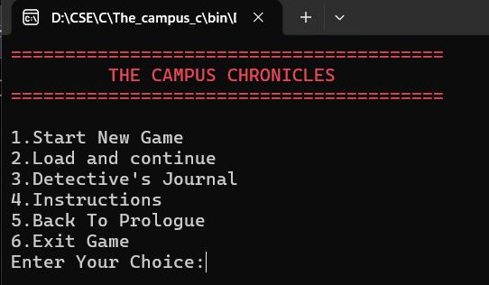
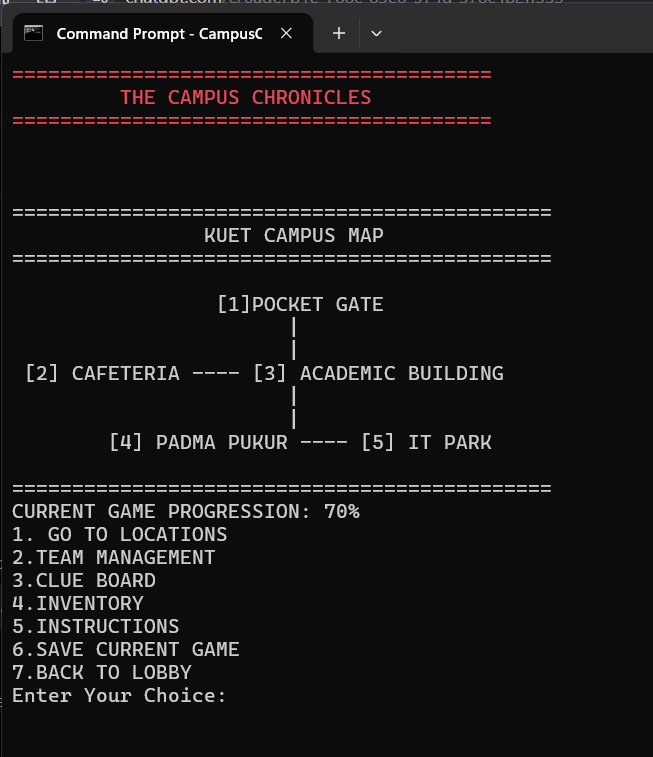
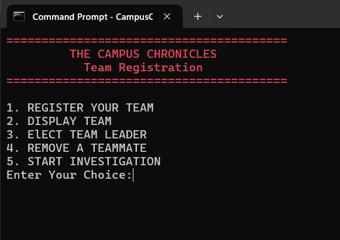
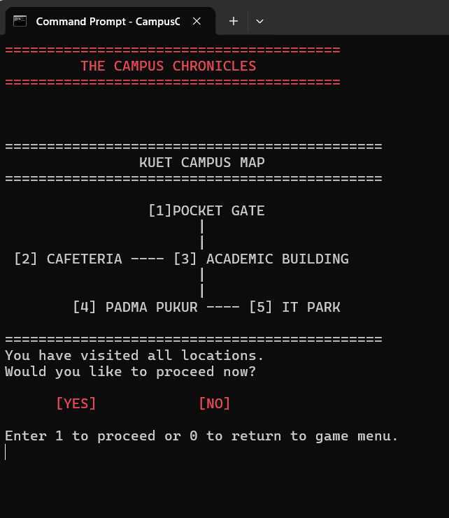
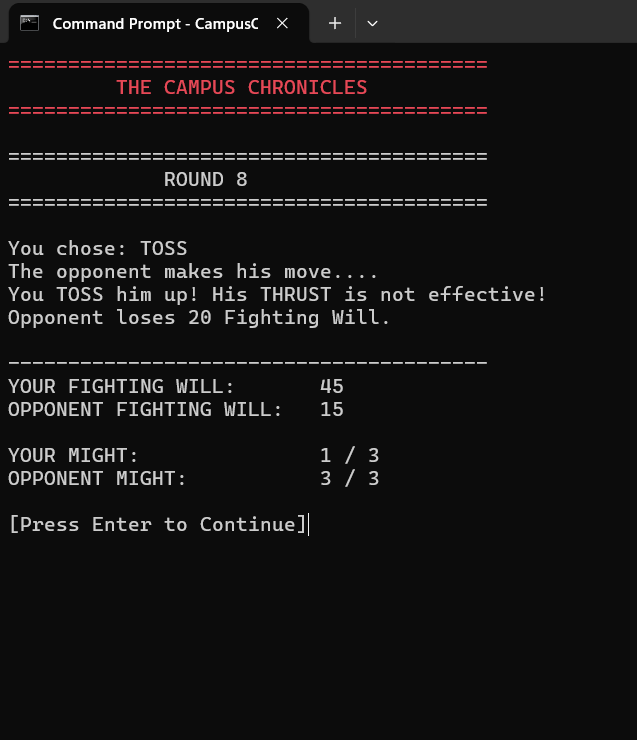

# The Campus Chronicles

> A short, story-driven mystery adventure game built in C and set around the KUET campus.

## About the Game

**The Campus Chronicles** is a terminal-based mystery adventure developed as a C programming project.

A few hours before the annual cultural show, the keys to the auditorium mysteriously disappear. Three students are chosen to investigate the mystery before the show begins.

Explore the campus, question suspicious characters, collect clues, solve puzzles, and make decisions that shape the investigation.

> **Three clues are true. Two are traps.**

Can your team recover the missing keys before the show begins?

## Gameplay

The investigation takes place across **five locations**:

- Pocket Gate
- Cafeteria
- Academic Building
- Padma Pukur
- IT Park

Players can start investigating from different locations and complete tasks to obtain clues. The collected clues are essential for progressing toward the final showdown.

The game includes:

- Story-driven mystery investigation
- Team of three detectives
- Team leader election system
- NPC interactions
- Puzzles and riddles
- Evidence and clue collection
- Mini-games
- Wrestling-style final showdown
- Detective's Journal
- Clue Board
- Inventory system
- Multiple investigation outcomes
- Save and Load system

## Screenshots

### Main Menu



### Game Menu & KUET Campus Map



### Team Registration



### All Locations Completed



### Combat System



## C Programming Concepts

This project was designed to demonstrate fundamental C programming concepts:

- Variables and operators
- Conditional statements
- Loops
- User-defined functions
- Arrays and strings
- Structures
- Pointers
- Enumerations
- File handling
- Dynamic memory allocation
- Header files
- Preprocessor directives
- Modular programming
- Makefile-based compilation

The goal was to combine these concepts into a single interactive application rather than using them only in isolated exercises.

## Project Structure

The project is divided into multiple C source files, with shared declarations and definitions organized through a header file.

```text
C_project/
├── main.c
├── open_menu.c
├── game_menu.c
├── team_manager.c
├── locations.c
├── pocket_gate.c
├── cafeteria.c
├── academic_building.c
├── padma.c
├── it_park.c
├── Finale.c
├── Cryptography.c
├── save_load.c
├── titles_pro_misc.c
├── titles.h
├── Makefile
├── *.txt
└── screenshots/
```

The **Makefile** is used to compile the multiple source files into the final executable.

## How to Run

### Requirements

- GCC
- GNU Make / MinGW Make
- Windows terminal or Command Prompt

### Build

Open a terminal in the project directory and run:

```bash
mingw32-make
```

### Run

After compilation:

```bash
CampusChronicles.exe
```

## Project Goal

The Campus Chronicles was created to demonstrate how fundamental C programming techniques can be combined to build a modular, interactive, story-driven application.

---

*Thank you for playing The Campus Chronicles!*
